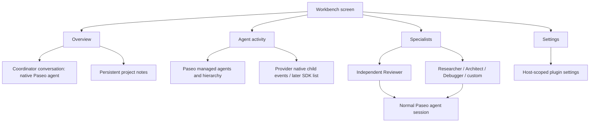
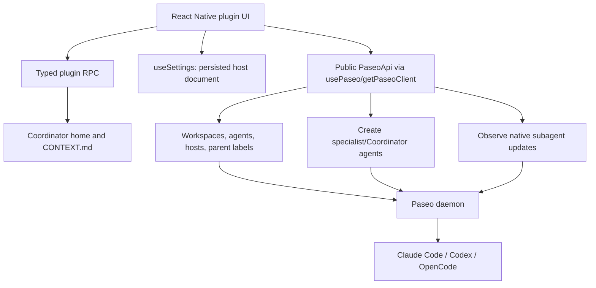

# Paseo Workbench: Product and Engineering Specification

**Version:** 0.1-alpha handoff, October 21, 2026  
**Target:** Paseo >= 0.12.0, TypeScript plugin, React Native surfaces on desktop/web/mobile  
**Status:** Scope agreed in conversation; scaffold implemented; integration validation outstanding  
**Owner:** Future maintainer / engineering implementer  

## 1. The product we want

A lightweight personal **agent workbench** on top of Paseo. The user wants to work with Claude Code naturally, without imposing a mission/task/orchestration framework on every interaction. The Workbench should create coherent cross-project awareness, expose what agents and subagents are doing, and provide opinionated but editable specialist operations (especially independent review). It should preserve Paseo's excellent remote access, mobile, projects, workspaces, agents and execution environment.

**Positioning:** better human-agent collaboration, not an autonomous software factory.

### Core product principles

1. **No workflow tax.** Ordinary Paseo/Claude Code sessions work unchanged; nothing requires an assigned Main, a bead, a mission, or a review.
2. **Reuse native infrastructure.** Paseo remains source of truth for workspaces, agents, status, tool calls, permissions, and chat. No duplicate execution framework.
3. **Opinionated specialists, optional use.** Reviewer has a good default methodology, but model/instructions can be customized. Helpers can launch contextually in one action.
4. **Visibility before autonomy.** The first value is knowing what is happening, not having another LLM decide what happens.
5. **Project organization means thinking, not bureaucracy.** Coordinator records user intent, decisions, and unresolved questions; never silently converts everything into tickets.
6. **Human permission remains explicit.** No automatic merging, pushing, deploying, or dangerous shell access. No hidden auto-review spending.
7. **Resilient to remote/multi-host usage.** Stable identities include server/host and project IDs. Offline hosts must not imply idle/no work.
8. **Represent partial observations honestly.** A live-only Claude-native child feed is not a complete history.

## 2. User journeys and acceptance criteria

### U1. Global overview (P0)
Open Workbench from the Paseo sidebar and see all visible projects across online connected hosts, number of active agents, and outstanding issues. Select a project; open its actual Paseo workspace. Details come from Paseo metadata, without token-consuming LLM inference.

**Acceptance:** with at least two repos and one connected remote host, UI groups by `(serverId, projectId)`; status and project count are correct; offline host reports unavailable instead of returning an empty project; `Open` resolves the proper host/workspace.

### U2. Personal Coordinator (P0)
Click **Create Coordinator** exactly once; obtain a persistent Paseo agent in a dedicated home, with the current project snapshot, user priorities, and helpful standing instructions. Chat naturally about priorities, ideas, and unresolved work. User can refresh the context manually as things change.

**Acceptance:** existing coordinator is rediscovered after app restart using labels; context file survives daemon restart; agent does not auto-spawn work; refreshing clearly indicates it sends a message and may consume tokens. Before beta, add concurrency-safe one-Coordinator-per-home semantics.

### U3. Durable project memory (P0)
Select a project, edit freeform Markdown/plaintext notes covering purpose, priorities, decisions, and parked ideas; Save; refresh Coordinator context when ready. User-authored decisions are distinguished from agent output.

**Acceptance:** notes persist across app restart and other connected devices of the same host; concurrent edits reject stale revisions rather than overwriting; no transcript or secrets automatically copied to settings.

### U4. Opinionated Reviewer (P0)
From a workspace or agent, launch independent Reviewer using custom instructions, model and optional provider permission mode, against uncommitted diff / branch / specified task. Reviewer inspects real files and diff, not just implementer's narrative. Result appears as a normal Paseo agent. No forced auto-review.

**Acceptance:** selecting scope passes specific non-ambiguous instructions; task-only review requires a task; Reviewer runs in a **fresh provider session** in the intended workspace and opens from the originating host; parent linkage when launched from an agent is represented correctly; review findings call out evidence; no claim of enforced read-only without verified provider policy.

### U5. Other helpers (P0)
Researcher, Architect, Debugger have independently editable role instructions. Can add a new specialist through Settings, override its model/mode, and launch it in the same workflow as Reviewer.

**Acceptance:** saving a profile affects subsequent launches; existing agents are not mutated. No need to author MCP servers for simple text-based roles.

### U6. Agent hierarchy (P0 partial; P1 full)
Display managed agents with true `paseo.parent-*` label relationships. Merge in native Claude/other provider children observed through `agent.provider_subagents.update`. Show statuses, descriptions, nested generation, and parent navigation.

**Acceptance P0:** shows managed children accurately; native subagents appear when events arrive after screen opens; a badge warns that history can be incomplete. **Acceptance P1:** after plugin opens late or device reconnects, tree is reconstructed from a public listing API; provider child can open its real read-only timeline. No attempt to send instructions directly to native provider-owned children.

### U7. Human attention (P0 basic; P1 refined)
Surface agent errors, permission prompts, and explicit attention flags in Overview. Link straight to agent. Future: deduplicate, group by project, show reviewer findings as structured cards, and distinguish decisions from pure status notifications.

**Acceptance:** zero LLM calls needed to populate; errors and permission items have grounded links; repeated status updates do not invent additional blockers.

### U8. Mobile and remote parity (P1)
Plugin renders usable adaptive UI on official mobile app, on web, and desktop, without requiring a custom mobile build. User can open the coordinator and agents on another Paseo host where authorized.

**Acceptance:** smoke tests on iOS and narrow desktop, proper safe areas, control sizes, no arbitrary network access, no assumptions about DOM, correct host-qualified navigation.

## 3. Proposed information architecture

**Primary views**

- **Overview:** Coordinator card (Open, Refresh/Create), Attention list, Projects with statuses, notes, and Open workspace.
- **Helpers:** explicit workspace/project selector; specialist presets; scope and task; Run action. No auto execution.
- **Activity:** hierarchical agents with status + provider, filters by project; interactive managed agent targets and read-only native targets.
- **Settings:** default model, Coordinator instructions, specialist name/description/instructions/model/mode; future per-project overrides.
- **Workspace panel:** fast launch in current workspace. **Agent panel:** review work launched as a managed child of an existing agent, with an independent context.

**Interaction contract:** UI controls must do an actual action or explain their disabled state. An assistant never acts merely because the user opens a dashboard. Provide explicit status/error handling and relevant agent links.

## 4. Architecture and module boundaries

### Data ownership

| Data | Source of truth | Persistence |
|---|---|---|
| Workspace/host/project identities | Paseo | Paseo daemon |
| Agent status and history | Paseo | Paseo daemon |
| Managed parent-child links | Paseo labels: `paseo.parent-agent-id`, `paseo.parent-server-id` | Paseo agent metadata |
| Provider-native children | Provider runtime via Paseo native feed | Paseo-managed; public plugin only sees live events today |
| Specialist instructions, model preferences | Workbench settings | Host-scoped Paseo settings document |
| User-authored project notes | Workbench settings | Host-scoped Paseo settings document |
| Coordinator identity | `workbench.role=coordinator` agent label | Paseo metadata |
| Coordinator context snapshot | Explicit user action | `~/.paseo/plugin-data/workbench/coordinator/CONTEXT.md` |
| User requests and review findings | Existing Paseo sessions | Paseo agent timelines |

### Host identities

Use `(serverId, projectId)`, `(serverId, workspaceId)`, and `(serverId, agentId)` for keys and navigation. Host labels are display-only. A different host may have identical local IDs or directory paths. Settings live on the host where Workbench is installed. In P0, place one Coordinator on that host and aggregate online app-known hosts through `useHosts` and `getPaseoClient`. No automatic replication of Workbench settings between independent installations.

### Backend

No independent MCP server or orchestration runtime. Backend only uses `server.registerSettings` and two strictly scoped RPCs: `workbench.coordinator_home` and `workbench.coordinator_context`. The latter writes only a fixed file in the plugin's own home, using atomic rename. It accepts a length-bounded Markdown payload; never an arbitrary filesystem destination.

### Update model

- Overview directory polls metadata every 15 seconds while visible. P1 should switch to owned `agents.list({subscribe:{}})` and `workspaces.list({subscribe:{}})` notifications, reconciled after reconnect.
- Native-subagent observer subscribes to `agent.provider_subagents.update` on each online app-known host. Only events received while subscribed are in the P0 UI memory; after reconnect use SDK list extension, not hidden file scraping.
- No implicit model calls on status refresh. `Refresh Coordinator context` is explicitly token-consuming and opt-in.

## 5. Specialist implementation and permission model

A specialist is a data record with `{id,name,description,instructions,model,modeId}`. Profile instructions are applied in `config.systemPrompt` and launch prompt, with an explicit task and scope. A launch uses `paseo.workspaces.ref(workspaceId).agents.create({config,title,prompt,labels,parent?})`. Project notes are contextual, not authority. Model resolution order: specialist override -> saved default -> existing agent on target host.

**Reviewer:** must assess the actual repository state and explain source of evidence. The UI must **never advertise read-only as enforced** if only an instruction prevents writes. Setting `modeId` is provider-specific and must be validated during live integration. Before general release, use a proven enforced review mode/worktree isolation strategy where available; otherwise disclose the limitation and request explicit confirmation for sensitive projects.

**Independent context:** each helper is a new Paseo session. Setting managed `parent` solely establishes ancestry and does not pass the parent's hidden conversation to the reviewer. The fresh reviewer should read local files and diff independently. Do not infer branch bases without inspecting git; report chosen base.

**No automation until explicitly enabled in a future version.** P1 could add optional review-on-finish rules with max-review budget, dedupe key `(host,agent,turnId,policyVersion)` and a global off switch; avoid unattended loops.

## 6. Global Coordinator and memory

The Coordinator is a regular, labeled Paseo agent hosted in a dedicated directory and backed by an editable snapshot. It should act as a thinking partner, not a default administrator. The snapshot should capture project names, host names, workspace names, selected agent statuses, and user-written notes, without dumping full conversations. The user can explicitly resync context; no background model calls or secrets extraction.

**P1 additions:** user-editable priority/idea/decision records, timestamps, links to source conversations, optional read-only tools to inspect Paseo project state live, semantic search over *user-approved* notes, and safeguards against hallucinated project memory. Distinguish "I decided" from "agent proposed" in UI and persistence.

## 7. Native-subagent SDK extension (DEFERRED)

Verified existing internals: `packages/client/src/daemon-client.ts` contains `listProviderSubagents(parentAgentId)` and `fetchProviderSubagentTimeline(parentAgentId,subagentId)`. The protocol already has listing, timeline, and `agent.provider_subagents.update` events; payloads include native `id`, managed `parentAgentId`, optional native `parentSubagentId`, title, description, status, and time. The built-in UI displays read-only provider-subagent timelines; it is NOT a normal managed Paseo agent.

**Smallest upstream change:** expose a public `PaseoApi.providerSubagents` read-only wrapper for list/history and a plugin navigation method to open the existing viewer (or provide an independent renderer). Do not change server runtime, invent new provider events, or conflate IDs. Add read-permission checks, connection-owned subscription cleanup, capability version detection, and tests for late subscriber, nested child, canceled child, restart, and missing provider support. Keep it a separate PR from the Workbench plugin.

**If refused:** a very small Paseo fork to carry public API wrappers is possible; favor backend RPC aggregation to avoid distributing a custom iOS client. Do not scrape session files or import private app modules. Rebase the fork only when needed; keep its commits isolated.

## 8. Security, privacy, performance

- Paseo plugins are **unsandboxed**, have daemon-user access, and should be code-audited before installation.
- Enable plugins only with user consent. Workbench never silently changes `daemon.mcp.injectIntoAgents` or model permission settings.
- No agent creation or token spending until an explicit click or direct user prompt.
- Avoid logging project notes or full model conversations in the plugin backend.
- Context file writes use a fixed directory, exclusive temp file and atomic rename; no user-supplied filesystem path.
- Project notes may contain confidential information; host settings and context are not secrets vaults. Do not ingest credentials or proprietary source by default.
- In the eventual permission queue, approval must invoke Paseo's real permission API and display the exact command/effect; no simulated approvals.
- Rate-limit directory refresh and avoid scanning full timelines to generate the dashboard; use metadata/events.
- Respect canceled/offline states; never show stale cached child feed as complete.
- Use Paseo colors, React Native components, platform-agnostic hooks, no DOM usage in shared UI.

## 9. Explicit non-goals for initial release

No Beads database, no Gas City rigs/packs, no mandatory project lead, no delegated mission DAG, no automatic multi-agent retries, no real-time screen-sharing, no persistent stream of every token, no GitHub/Slack/TickTick ingestion, no task inference from private sessions, no automatic commit/push/merge, no bespoke web service, and no fork of Paseo yet.

## 10. Acceptance test matrix

| Test | P0 expected behavior |
|---|---|
| Empty first install | Clear onboarding, no phantom Coordinator, no auto agent |
| Default model unknown | Explain how to choose a valid provider/model; do not guess |
| Create Coordinator | One labeled agent, home path correct, normal Paseo chat opens |
| Restart host/app | Coordinator rediscovered, notes/settings preserved |
| Manual context refresh | `CONTEXT.md` updated; explicit notification sent once |
| Two local repos | Correct project grouping and counts |
| Two hosts same project ID | Separate rows, correctly qualified links |
| Remote disconnected | Failure shown, no false "all clear" |
| Launch Reviewer from workspace | Fresh session in selected workspace with explicit scope |
| Launch Reviewer from agent | Fresh managed child with correct parent and provider |
| Unsupported model or mode | Error shown; no silent fallback to unsafe mode |
| Reviewer instructions | Saved edit included in next launch, old sessions unchanged |
| Native child starts after viewing | Appears beneath correct parent, including nested children |
| Plugin opened after native child starts | Explicit partial-observation notice; no fabricated history |
| Reviewer write attempt | Permission boundary evaluated; no "read only" promise unless enforced |
| Multiple device settings edit | Optimistic revision conflict surfaced |
| iOS narrow viewport | No horizontal overflow or inaccessible controls |
| Disable/remove plugin | Other Paseo sessions continue normally |

## 11. Milestones and delivery criteria

**M0: source prototype (included)**. Core screen/actions/settings, manually launched coordinator/roles, notes, basic hierarchy, offline tests. Not validated in a running daemon.

**M1: actual local integration (release gate)**. Install against Paseo >= 0.12.0, resolve TypeScript SDK mismatches, use a real Claude agent, save notes, launch Review in a harmless scratch repository, verify permission modes, test desktop/mobile and restart. Fix bugs found. Must be completed before calling this production-ready.

**M2: reliable operator experience**. Reconcile subscriptions after reconnect; persist native child initial state via SDK extension or honestly show live-only; add model picker from provider catalog, role CRUD, review findings structured UI, concurrency-safe Coordinator identity, project filtering, approval queue.

**M3: advanced workbench**. Optional automated reviews with dedupe and budgets, configurable review recipes, per-project specialist overrides, durable searchable project decisions, cross-host coordinator reads, and robust native-child drilldown.

## 12. Architecture decisions (initial)

- **ADR-001: Plugin not fork**. Keep all product UI/workflows in the plugin. Core modifications only to expose generic reusable SDK APIs.
- **ADR-002: Native Paseo sessions**. No shadow chat interface or duplicate session engine.
- **ADR-003: Manual-first**. Observation and explicit user actions before background orchestration.
- **ADR-004: Separate coordinator and specialists**. Coordinator is a thought partner; Reviewer is a fresh operation/session.
- **ADR-005: Labels for identity, settings for preferences**. Durable agent IDs discovered from Paseo labels, not a second agent registry.
- **ADR-006: No false completeness**. Native subagent observability shows best-effort live updates until SDK listing exists.

## 13. Maintainer source references

- Plugin quickstart: https://paseo.sh/docs/plugins
- Plugin SDK reference: https://paseo.sh/docs/plugins/reference
- Paseo agent API: https://paseo.sh/docs/sdk/agents
- General SDK API: https://paseo.sh/docs/sdk/reference
- Native subagents design: https://github.com/getpaseo/paseo/blob/main/docs/agent-lifecycle.md
- Native subagent transport: https://github.com/getpaseo/paseo/blob/main/packages/client/src/daemon-client.ts
- Native subagent protocols: https://github.com/getpaseo/paseo/blob/main/packages/protocol/src/messages.ts

The implementation was authored using the published SDK documentation and the upstream source tree as inspected October 21, 2026. Verify compatibility against the actual installed Paseo release and lock versions for reproducible builds.
